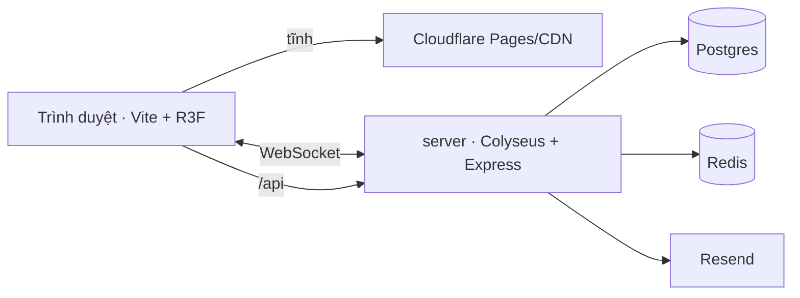

# 01 · Kiến trúc

`web/` Vite + React 19 + React Three Fiber + colyseus.js → build tĩnh lên Cloudflare Pages (0 đ). `server/` một tiến trình Node 22: Colyseus 0.18 (TempleRoom ×10) + Express 5 (/api) + Prisma 7 → Postgres 16 + Redis 7, Docker trên VPS 4 GB. `shared/` Zod schema + hằng số dùng chung. Không Next.js (không cần SEO nội dung), không serverless (WebSocket).

| Thành phần | Chọn | Phiên bản (npm 01/11/2026) |
|---|---|---|
| Web | vite 8, react 19.3, three 0.187, @react-three/fiber 9.8, drei 10.7, colyseus.js 0.16, zustand 5, tailwind 4 | xem `web/package.json` |
| Server | node 22, colyseus 0.18, express 5, prisma 7.10, ioredis 6, jose 6, resend 6, zod 4 | `server/package.json` |
| Deploy | Pages từ GitHub; server Docker → VPS (Coolify hoặc compose) | CI: `.github/workflows/ci.yml` |
| Giám sát | Sentry, Uptime Kuma, Better Stack | – |

Chi phí: VPS ~250k + domain ~70k/tháng ≈ 320k VND. Scale: VPS thứ hai + Redis presence chung của Colyseus.

## API (Express)
`POST /api/session` → JWT 10 phút (guestId hoặc userId) · `POST /api/auth/magic-link` · `GET /api/auth/verify?token=` · `POST /api/auth/logout` · `GET /api/me` · `PATCH /api/me` (tên, tên Tiểu An) · `GET /api/merit/today` · `GET /api/rooms` · `/api/admin/*` (TOTP).

## Bảo mật
Token magic link chỉ hash, 15 phút · rate limit auth 5/15 phút/IP, message 10/s/client · JWT HS256 · cookie httpOnly/Secure/Lax 30 ngày · CSP self + Cloudflare · không PII ngoài email · xóa tài khoản tự phục vụ (NĐ 13/2023).

## Test
unit (Vitest): luật công đức, nội suy, lịch ngày/đêm · room (Colyseus test client): join/queue/seat/cooldown · e2e (Playwright): vào chùa, thắp hương, thấy toast · load: 1.000 kết nối giả lập trước ra mắt.
