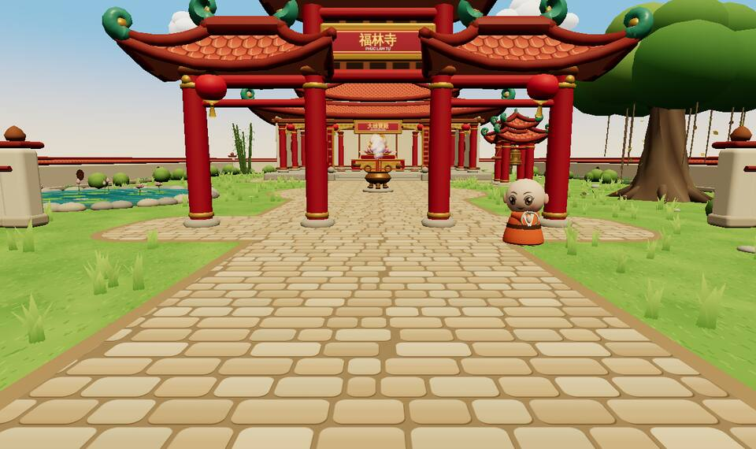
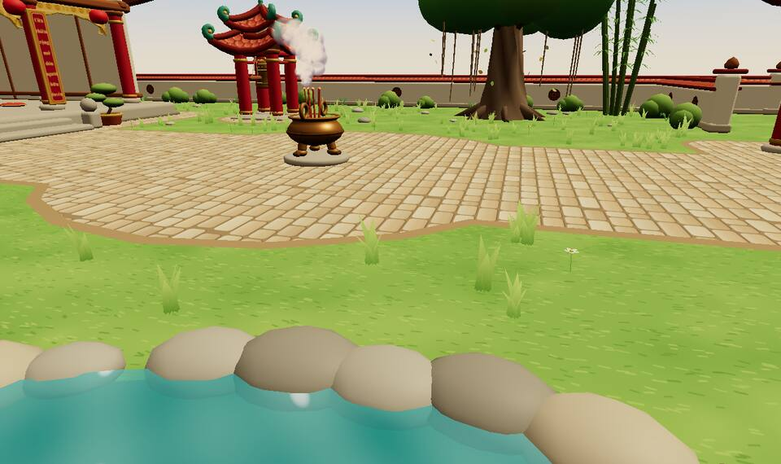
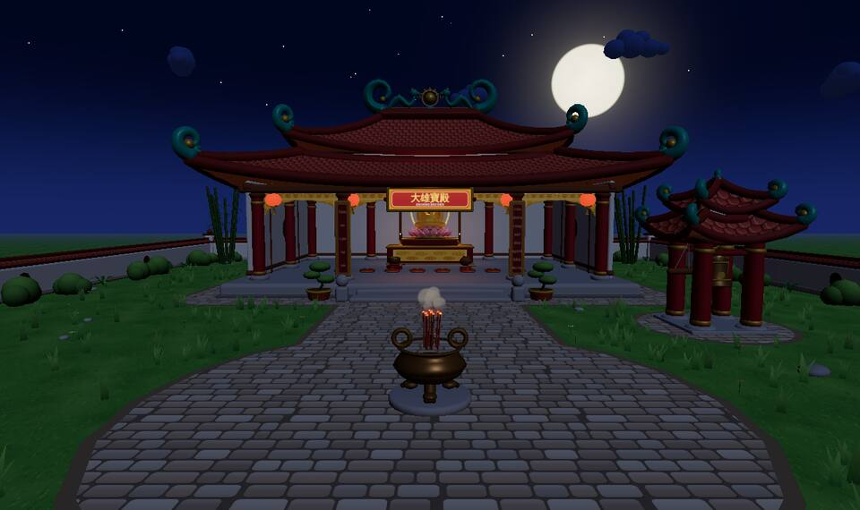

# 07 · Rà soát giao diện & đề xuất nâng độ thật

Ngày 01/11/2026 · rà trên nhánh mới nhất `claude/eager-noether-i0civq` (commit `0f79f76`, đã gộp 5 nhánh chibi + sửa lỗi).
Cách rà: chạy `vite` + `scripts/shot.cjs` (Chromium headless, SwiftShader), chụp ban ngày 10h VN, ban đêm 21h VN, màn cổng, màn 390×844; đọc mã `web/src/scene/**`, `web/src/ui/**`, `shared/src/palette/**`. Ảnh: `docs/review/img/`.

| Ban ngày — tam quan | Ban ngày — ao sen, lư hương | Ban đêm — chính điện |
|---|---|---|
|  |  |  |

## 0. Kết luận nhanh

Cảnh hiện tại **sạch, đủ vật thể, chạy không lỗi**, nhưng nhìn "giống đồ chơi nhựa" chủ yếu vì 5 lý do kỹ thuật — không phải vì hình khối chibi:

1. **Không có ánh sáng môi trường (IBL/envMap)** → vàng, đồng, sơn mài, nước trông phẳng như nhựa màu.
2. **Không có che khuất (AO) và bóng tiếp xúc** → cột, lư hương, bụi cây, đá "lơ lửng" trên nền.
3. **Vật liệu chỉ có màu (map)**, không normal/roughness map; nhiều chỗ "ăn gian" bằng `emissive` (mái dưới 0,35, trần 0,9, tượng Phật 0,12) → mất chiều sâu.
4. **Bảng màu bão hòa, sạch, không lão hóa** (cột đỏ `#B8322E` bóng, tường vôi trắng tinh, gạch đều tăm tắp, cỏ xanh chuối) → không có cảm giác chùa làng trăm năm.
5. **Kiến trúc đang mang dáng Trung Hoa/Huế** (cổng gỗ sơn đỏ kiểu paifang, đầu đao xoắn xanh ngọc) hơn là **chùa làng Bắc Bộ** (cột lim nâu trần, ngói mũi hài nâu xám rêu phong, tường vôi vàng ố, tam quan gác chuông xây gạch).

Sửa 1–3 cho độ thật tăng rõ mà **không cần thêm package** (three/examples và drei đã có sẵn), tốn ~0–1,5 MB tải. Sửa 4–5 là quyết định thẩm mỹ, cần Phương chốt.

## 1. Quyết định cần Phương chốt trước

Ngày 01/11 Phương đã chọn **chibi toàn cảnh** (`docs/06-chibi-plan.md`). Yêu cầu "độ thật tốt hơn" cần chọn một trong ba hướng:

| Hướng | Mô tả | Chi phí | Ghi chú |
|---|---|---|---|
| A. Giữ chibi, chỉ nâng render | Giữ hình khối + màu; thêm IBL, AO, bóng mềm, hậu kỳ | 1 tuần | Đẹp hơn kiểu "phim hoạt hình 3D", vẫn không thật |
| **B. Nhân vật chibi + cảnh bán thực (khuyến nghị)** | Người chơi/Tiểu An giữ chibi; kiến trúc, cây, sân chuyển sang tỷ lệ thật, vật liệu PBR có lão hóa, đúng chùa Bắc Bộ | 3–4 tuần | Kiểu *Sky: Children of the Light* / Ghibli 3D: nhân vật dễ thương, không gian trang nghiêm, có "hồn" |
| C. Thực toàn phần | Model chuyên nghiệp quét/thuê, nhân vật tỷ lệ thật | 6–10 tuần + thuê model | Đụng "câu hỏi mở 4" (thuê model 3D); nặng mobile; nhân vật thật dễ "thung lũng kỳ lạ" |

Khuyến nghị **B**: chỗ kém thật nhất là môi trường; nhân vật chibi vẫn giữ được sự thân thiện, và chibi đứng trong không gian thật lại làm không gian trông tôn nghiêm hơn.
Hệ quả: bỏ quy tắc "không tải ảnh/texture file" trong `06-chibi-plan.md`, thay bằng ngân sách texture KTX2 (mục 3).

## 2. Rà soát từng chi tiết + đề xuất

Ưu tiên: **P1** làm ngay (đổi nhiều nhất/chi phí thấp) · **P2** đợt 2 · **P3** khi có model/thời gian.

### 2.1 Ánh sáng & kết xuất (`scene/Lighting.tsx`, `env/look.ts`, `App.tsx`)

| # | Hiện trạng | Vấn đề | Đề xuất | Ưu tiên |
|---|---|---|---|---|
| 1 | Chỉ `hemisphereLight` + `directionalLight`; không `scene.environment` | Kim loại (tượng vàng, lư đồng, chuông) không có gì để phản chiếu → màu phẳng | Tạo envMap **không cần file**: `PMREMGenerator.fromScene(new RoomEnvironment())` hoặc drei `<Environment resolution={64}>` với `<Lightformer>` (dải trời + đất ấm); đổi theo ngày/đêm bằng 2–3 bản bake sẵn, không bake mỗi khung | P1 |
| 2 | Bóng 2048² phủ 120×120 m (~6 cm/texel), PCF soft | Bóng nhòe, mất chân cột/ chân người; không có bóng mềm theo khoảng cách | Thu khung bóng theo người chơi (±25 m, dịch theo bước texel để không rung) → ~2,4 cm/texel; hoặc drei `<SoftShadows>` (PCSS) cho máy khá; máy yếu giữ như cũ | P1 |
| 3 | Không AO | Vật thể không "ngồi" trên nền, góc mái/hiên sáng như ngoài trời | Hậu kỳ **GTAO** (`three/examples/jsm/postprocessing/GTAOPass`) bật ở máy khá; drei `<ContactShadows>` dưới lư hương, avatar, bồ đoàn; về lâu dài bake AO vào lightmap (mục 2.3) | P1 |
| 4 | Không hậu kỳ (render thẳng, ACES mặc định của R3F) | Thiếu "chất phim": quầng đèn lồng, nến; tương phản phẳng | `EffectComposer` của three/examples (không thêm package): GTAO → Bloom nhẹ (ngưỡng cao, chỉ đèn/nến/trăng) → OutputPass (AgX hoặc Neutral tone mapping) → vignette nhẹ; SMAA thay MSAA khi bật composer | P1 |
| 5 | Ánh sáng "ăn gian" hướng +z để mặt tiền luôn sáng | Bóng luôn đổ cùng phía, không cảm nhận giờ trong ngày | Bỏ ăn gian; dùng envMap + fill light yếu cho mặt tiền; giữ đúng hướng mặt trời theo giờ VN (đã có `ph.sun`) | P2 |
| 6 | Fog tuyến tính màu chân trời | Xa vẫn nét, không có không khí ẩm Bắc Bộ | `FogExp2` mật độ thấp + màu fog lấy từ trời gần chân trời; sáng sớm/sương: thêm 1–2 lớp mặt phẳng sương thấp (billboard alpha, depth fade) quanh ao và chân tường | P2 |
| 7 | Ban đêm: cỏ vẫn xanh bão hòa, tường sáng trắng, trăng cực to | Không ra đêm, giống ban ngày bị tối đi | Giảm bão hòa toàn cảnh về đêm (color grading trong pass cuối), ánh trăng xanh lạnh yếu hơn, **đèn lồng/nến là nguồn sáng chính ấm** (tương phản ấm–lạnh); đĩa trăng nhỏ lại ~40 %, thêm quầng | P1 |
| 8 | Trong chính điện sáng đều bằng emissive trần/mái | Không có cảm giác điện tối, linh thiêng | Bỏ emissive trần/mái; ánh sáng vào từ cửa (spot rộng/area light giả) + 2 nến + đèn dầu trên ban thờ; tượng Phật sáng nhờ envMap + rim light nhẹ, không tự phát sáng | P1 |

### 2.2 Vật liệu & texture (`scene/materials.ts`, `scene/textures.ts`, `nature/natureMaterials.ts`)

| # | Hiện trạng | Vấn đề | Đề xuất | Ưu tiên |
|---|---|---|---|---|
| 9 | Texture vẽ canvas, chỉ kênh màu | Không có gồ ghề, mạch vữa không lõm, mặt đá/gỗ trơn | Bộ PBR CC0 (ambientCG / Poly Haven, giấy phép CC0) 1024², 4 kênh (màu, normal, ORM gộp AO/roughness/metal) nén **KTX2/Basis** (`KTX2Loader` có sẵn trong three/examples) ~250–350 KB/bộ | P1 |
| 10 | Cột đỏ son bóng (roughness 0,55), đều màu | Trông như nhựa mới | Cột Bắc Bộ: **gỗ lim nâu sẫm** để mộc hoặc sơn then cũ; normal vân gỗ, roughness 0,6–0,75, vệt mòn ở độ cao tay người | P2 (theo hướng B) |
| 11 | Ngói vảy đỏ cam `#C8553D` đều | Không giống ngói mũi hài lâu năm | Ngói mũi hài nâu đỏ sẫm + biến thiên từng viên (vertex color/instance color), rêu xanh xám ở rìa và rãnh nước, tối dần về phía bờ nóc | P1 |
| 12 | Tường vôi `#F3E6CC` sạch, viền đỏ | Như tường mới sơn | Vôi vàng ố, chân tường ẩm thẫm + rêu (decal hoặc mask theo chiều cao trong shader), vệt nước chảy từ mái | P1 |
| 13 | Sân gạch be/đá xám đều, viền nâu dày kiểu hoạt hình | Gạch chibi tròn cạnh, đều quá | Gạch Bát Tràng đỏ vuông 30 cm (sân) + đá xanh (lối đi), mạch vữa lõm (normal), mòn ở lối đi chính (mask), rêu ở mạch vữa phía bóng râm | P1 |
| 14 | Vàng, đồng `metalness 0,45–0,6` không envMap | Màu cam đục | Sau #1: vàng thếp metalness 1, roughness 0,3 + roughness map xước; đồng lư hương patina xanh ở chỗ lõm, sáng bóng ở quai (chỗ tay chạm) | P1 |
| 15 | Emissive dùng để "chống tối" ở nhiều vật liệu | Làm phẳng hình khối | Gỡ emissive khỏi `roofUnder`, `ceiling`, `buddha*`, `lotusThrone*`, `goldCarve`; giữ emissive chỉ cho vật thật sự phát sáng (đèn, nến, đốm hương) | P1 |

### 2.3 Kiến trúc (`Gate`, `Hall`, `Roof`, `arch/**`, `Walls`, `BellTower`, `Columns`)

| # | Hiện trạng | Vấn đề | Đề xuất | Ưu tiên |
|---|---|---|---|---|
| 16 | Tam quan: cổng gỗ 3 mái, cột đỏ, đầu đao xoắn xanh ngọc | Dáng cổng Trung Hoa; không đặc trưng Bắc Bộ | **Tam quan gác chuông xây gạch** 2 tầng 8 mái (như chùa Keo, Mía…): trụ biểu vuông có lồng đèn + nghê; tầng trên treo chuông; mái ngói mũi hài; hoành phi chữ Hán trên cửa giữa | P2 |
| 17 | Đầu đao xoắn tròn, màu men xanh ngọc to | Quá "chibi", sai chất liệu (đầu đao Bắc Bộ là đắp vữa/sành, dáng lá/guốc) | Đầu đao cong vút dáng lá lật, đắp vữa màu xám/nâu; bờ nóc **lưỡng long chầu nguyệt** (rồng đắp vữa, mặt nguyệt ở giữa) | P2 |
| 18 | Mái độ dốc nhỏ, đuôi cong đều | Thiếu "độ võng" và độ dày mái đặc trưng | Mái dốc lớn hơn (~40°), độ võng giữa, viền mái dày có ngói ống/ngói lót; tàu mái lộ kèo, bẩy, đấu (hình khối thật, ít tam giác qua instancing) | P2 |
| 19 | Chính điện hở 3 mặt, sàn đá sáng, tường vôi sáng | Thiếu chiều sâu, điện như sân khấu | Mặt tiền **cửa bức bàn** gỗ (mở 3 gian giữa), hiên có cột hiên; trong điện tối hơn, sàn gạch đỏ bóng nhẹ, xà kèo chạm lộ ra | P2 |
| 20 | Ban thờ 1 tầng, tượng Phật đơn | Chùa Bắc Bộ có Phật điện nhiều cấp (Tam Thế, A Di Đà, Thích Ca…) | Phật điện 3 cấp bậc (giai đoạn đầu chỉ 1 tượng chính + 2 tượng nhỏ hai bên, ít tam giác), nhang án, đỉnh đồng, hạc thờ, mâm bồng hoa quả, cờ phướn | P2 |
| 21 | Tượng Phật bằng khối tròn, mặt vẽ canvas, tự phát sáng | Đã trang nghiêm nhưng nhìn như đồ nhựa vàng | Model glTF tượng ngồi (~8–12k tam giác, CC0/thuê) + vàng thếp có xước, sơn son ở bệ, envMap; bỏ emissive; ánh nến hắt từ dưới | P2–P3 |
| 22 | Hoành phi/câu đối: chữ Quốc ngữ xếp dọc từng từ | Đọc ngắt quãng, không giống câu đối thật | Câu đối 3D: chữ Hán (như hoành phi) **hoặc** thư pháp Quốc ngữ ngang trên biển; câu đối gỗ sơn then, chữ thếp vàng nổi (normal map) | P1 |
| 23 | Tường bao thấp, ô tròn, trụ cổng bo tròn | Giống tường vườn mới xây | Tường gạch trát vôi cao hơn (2,5 m), mái ngói nhỏ trên đỉnh, ô thoáng hoa chanh/chữ thọ bằng sành; vết bong vữa lộ gạch | P2 |
| 24 | Kiến trúc dựng thủ tục (procedural) toàn bộ | Khó đạt chi tiết thật mà vẫn rẻ | Chuyển dần kiến trúc tĩnh sang **glTF + Draco/Meshopt** (loader có sẵn trong three/examples) dựng trong Blender, **bake lightmap/AO** cho ngày và đêm (2 bộ, 1024–2048, KTX2). Đây là nâng cấp độ thật lớn nhất | P3 (gắn với câu hỏi mở 4) |

### 2.4 Thiên nhiên & sân vườn (`Ground`, `nature/**`, `LotusPond`, `BanyanTree`)

| # | Hiện trạng | Vấn đề | Đề xuất | Ưu tiên |
|---|---|---|---|---|
| 25 | Nền cỏ một màu xanh sáng + cụm cỏ thưa | Như thảm nhựa | Đất nền có biến thiên màu (noise vùng khô/ẩm, lối mòn), cỏ dày ở rìa tường bằng instanced cards (2 nhóm LOD), chuyển tiếp cỏ–gạch có viền đất | P1 |
| 26 | Cây đa: tán là cụm cầu lớn, rễ phụ là que thẳng | Dấu hiệu "low-poly" rõ nhất trong ảnh | Tán bằng **leaf cards** (alpha-test, normal hướng cầu, translucency giả) + thân có rễ bạnh, rễ phụ rủ cong; đung đưa bằng `withWindSway` sẵn có | P1 |
| 27 | Tre: que thẳng mảnh, ít lá | Không ra bụi tre làng | Bụi tre cong vồng, đốt rõ, lá cards; khóm tre đặt sau tường, che bớt đường chân trời trống | P2 |
| 28 | Đường chân trời trống, mặt cỏ phẳng tới vô tận | Chùa như đặt trên sân bóng | Vành cảnh xa: lũy tre làng, mái nhà thấp, cánh đồng lúa, đồi mờ (billboard/impostor 1 draw call), fog che rìa | P1 |
| 29 | Ao: nước xanh ngọc đục, đá viền tròn to đều | Không phản chiếu, đá như gối | Nước: Fresnel + phản chiếu trời từ envMap + normal map gợn sóng trôi theo gió; drei `MeshReflectorMaterial` chỉ khi máy khá. Kè ao bằng đá ong/gạch, có rêu, đá không đều; sen lá to hơn, có lá úa, có cuống | P1 |
| 30 | Bụi cây cầu tròn, chậu cảnh | Đồ chơi | Bụi cây lá cards; cây cảnh dáng thế (bonsai) trên chậu sứ men lam; hàng cau, cây đại (hoa sứ trắng — rất đặc trưng chùa Việt) | P2 |

### 2.5 Trời & thời tiết (`env/Sky.tsx`, `env/WeatherFx.tsx`, `lib/weather.ts`)

| # | Hiện trạng | Vấn đề | Đề xuất | Ưu tiên |
|---|---|---|---|---|
| 31 | Vòm trời gradient 2 màu | Phẳng | Mô hình tán xạ khí quyển (drei `<Sky>` — Preetham, có sẵn) cho ngày + hoàng hôn; tông trời ngả trắng sữa ẩm của Bắc Bộ | P1 |
| 32 | Mây = cụm cầu instanced, cả đêm lẫn ngày | Như bông gòn | Mây là sprite/billboard volumetric giả (2–3 texture KTX2) hoặc drei `<Clouds>`; ban đêm mây mỏng có viền trăng | P2 |
| 33 | Trăng: đĩa trắng rất to, phẳng | Không thật | Đĩa nhỏ hơn, có texture bề mặt, quầng mờ (bloom), sao nhỏ lấp lánh nhẹ | P1 |
| 34 | Mưa phùn GPU (đã có) | Chưa có mặt đất ướt | Khi `env.rain` > 0: giảm roughness nền/gạch (sàn ướt bóng), vệt đọng nước, giọt rơi trên mặt ao (ripple) | P2 |

### 2.6 Hương khói, đèn, hiệu ứng (`Smoke.tsx`, `IncenseBurner.tsx`, `Lanterns.tsx`, `fx/**`)

| # | Hiện trạng | Vấn đề | Đề xuất | Ưu tiên |
|---|---|---|---|---|
| 35 | Khói = cụm puff trắng đục kiểu hoạt hình | Như bông, không thấy "sợi khói" | Khói hương thật là **sợi mảnh, xoắn, mờ dần**: dải ribbon (trail) theo đường curl-noise từ đầu mỗi nén + vài puff rất mờ phía trên; màu xám xanh, alpha thấp, có độ tán sáng ngược nắng | P1 |
| 36 | Nén hương thẳng, đốm đỏ | Thiếu chân nhang đỏ, tro | Chân nhang đỏ, thân vàng nâu, đầu tàn xám + đốm đỏ bloom; lư hương có tro mịn và chân nhang cũ cắm dày | P1 |
| 37 | Đèn lồng đỏ tròn kiểu Trung Hoa, ban ngày cũng đỏ rực | Chói, ít Việt | Ít đèn hơn; đèn lồng vải lụa đỏ/vàng có khung tre lộ khi đèn sáng (transmission giả), tua; thêm **đèn dầu/nến** trong điện, đèn lưu ly trên ban thờ | P2 |
| 38 | Hiệu ứng nghi lễ: 12 vòng sáng cộng sáng, 160 hạt sáng, đóa sen sprite | Cảm giác "game" (vòng sáng, hạt bay) lệch tôn nghiêm và kém thật | Thay bằng hiệu ứng vật lý: gõ chuông → rung chuông + sóng âm mờ trong không khí (distortion nhẹ); trọn tràng → ánh nến lay; tránh hạt lấp lánh | P2 |

### 2.7 Nhân vật (`chibi/rig.ts`, `chibi/motion.ts`, `TieuAn.tsx`)

| # | Hiện trạng | Vấn đề | Đề xuất | Ưu tiên |
|---|---|---|---|---|
| 39 | Rig chibi khối tròn, vải trơn | Lệch với cảnh nếu cảnh thật hơn | Giữ chibi (hướng B) nhưng: vải có normal map sợi vải thô (áo nâu sồng), nếp gấp bake, viền rim light; bóng tiếp xúc dưới chân | P2 |
| 40 | Màu áo Tiểu An cam (theo ảnh tham chiếu) | Câu hỏi còn mở | Hướng B → nâu sồng/lam chuẩn chùa Bắc Bộ, khăn vàng giữ để nhận diện (`docs/04-visual-audio.md`) | Quyết định |
| 41 | Đi bộ lạch bạch, không có bước chân | Thiếu tương tác với nền | IK chân đơn giản bám bậc thềm; bụi nhẹ trên sân đất; tiếng bước chân theo vật liệu (gạch/cỏ/gỗ) | P3 |

### 2.8 Camera & chuyển động

| # | Hiện trạng | Vấn đề | Đề xuất | Ưu tiên |
|---|---|---|---|---|
| 42 | FOV 55, camera bám lưng góc cao | Góc nhìn "game"; công trình bị thu nhỏ | FOV 45–50, hạ camera gần tầm mắt khi đứng trong sân/điện (tự động khi vào vùng chính điện), giữ góc cao khi đi ngoài | P1 |
| 43 | Mở cảnh bằng camera quay vòng | Thiếu khoảnh khắc "đến chùa" | Đoạn mở 6–8 s: camera đi dọc lối đá qua tam quan, sương sớm tan, tiếng chuông xa; bấm để bỏ qua | P2 |
| 44 | Không có độ sâu trường ảnh | — | DoF nhẹ (bokeh) chỉ khi lễ Phật/ngồi thiền, tập trung tượng | P3 |

### 2.9 Giao diện 2D (`ui/**`, `styles.css`)

| # | Hiện trạng | Vấn đề | Đề xuất | Ưu tiên |
|---|---|---|---|---|
| 45 | Màn cổng: SVG mái vẽ tay, chữ "PHÚC LÂM TỰ" tràn khỏi biển đỏ ([ảnh](img/man-cong.jpg)) | Lỗi hiển thị + hình mái quá đơn | Biển nới rộng/đặt `textLength`; thay SVG bằng chính cảnh 3D tam quan ở nền (đã render phía sau) với vignette, bỏ khối SVG | P1 |
| 46 | Câu đối màn cổng chữ dọc Quốc ngữ | Khó đọc, không đúng thư pháp | Hai câu đối ngang thư pháp (font serif hiện có, hoặc chữ Hán + phiên âm nhỏ) | P1 |
| 47 | HUD mobile 3 hàng chip + nút Rời chùa ([ảnh](img/dem-mobile.jpg)) | Chiếm ~20 % màn, che mái chùa | Gộp: tên + số người một chip; công đức/hạt một chip; giờ + thời tiết thành biểu tượng nhỏ; nền chip mờ hơn (alpha 0,55) | P1 |
| 48 | Chip, nút, bong bóng dùng nền nâu đặc + viền vàng | Cảm giác "app" chồng lên cảnh | Chất liệu UI gợi giấy dó/sơn mài: nền gradient mờ, viền mảnh, bóng đổ mềm; icon nét bút lông; giảm số viền vàng | P2 |
| 49 | Gợi ý phím luôn hiện (màn hẹp không cảm ứng thì chồng nút) | Rối | Ẩn sau 10 s hoặc sau lần di chuyển đầu; nút "?" mở lại | P1 |
| 50 | Font tải từ Google Fonts | Phụ thuộc mạng ngoài, nháy font | Tự host `web/public/fonts` (đã có trong việc kế tiếp tuần 2), subset tiếng Việt, `font-display: swap` | P1 |
| 51 | Tràng hạt: canvas 2D | Lệch với cảnh 3D thật | Tràng hạt 3D (instanced, hạt gỗ có vân, envMap) trong overlay, vuốt có quán tính + tiếng hạt | P2 |

### 2.10 Âm thanh hỗ trợ cảm giác thật (`audio/synth.ts`)

| # | Đề xuất | Ưu tiên |
|---|---|---|
| 52 | Âm thanh theo không gian: `PannerNode` cho chuông, mõ, gió tre theo vị trí nguồn; người khác gõ mõ nghe xa gần | P2 |
| 53 | Vang trong chính điện: `ConvolverNode` với impulse response **tổng hợp** (noise tắt dần — không cần file, đúng quy ước chỉ tổng hợp), bật khi người chơi vào điện | P2 |
| 54 | Lớp nền theo giờ: sáng gà gáy xa/chim sẻ, trưa ve sầu (mùa hè), tối dế + ếch; tổng hợp hết | P3 |

## 3. Ngân sách & ràng buộc

- **Không thêm package**: mọi đề xuất P1–P2 dùng `three/examples/jsm` (EffectComposer, GTAOPass, UnrealBloomPass, OutputPass, SMAAPass, KTX2Loader, DRACOLoader, RoomEnvironment) và drei (Environment, Lightformer, ContactShadows, SoftShadows, Sky, Clouds, MeshReflectorMaterial) đã có. Chỉ cần thêm file transcoder Basis (~500 KB, đi kèm three) vào `web/public`.
- **Tải ≤ 8 MB**: dự kiến texture KTX2 ~6 bộ × 300 KB ≈ 1,8 MB; glTF kiến trúc (Draco) ~1–1,5 MB; lightmap 2×1 MB; tổng thêm ≈ 4–5 MB → vẫn dưới 8 MB (hiện 361 KB gzip).
- **30 fps máy tầm trung**: 3 mức chất lượng tự chọn theo `isLowEnd()` + đo FPS 5 s đầu:
  - *Thấp*: không composer, bóng 1024 bám người chơi, không AO, envMap tĩnh.
  - *Vừa*: Bloom + OutputPass, ContactShadows, bóng 2048 bám người chơi.
  - *Cao*: thêm GTAO nửa độ phân giải, SoftShadows, reflector ao.
- **Tôn nghiêm**: không thêm chữ/quảng cáo; hiệu ứng tránh lấp lánh "game"; tượng Phật dùng model trang nghiêm, có người duyệt.
- **Quy tắc cần sửa nếu chọn B**: `docs/06-chibi-plan.md` mục "Không tải ảnh/texture file" → "texture KTX2 CC0 ≤ 1024², tổng ≤ 2 MB"; `docs/04-visual-audio.md` cập nhật palette (lim, ngói mũi hài, vôi vàng, gạch Bát Tràng).

## 4. Lộ trình đề xuất

| Đợt | Nội dung | Thời gian | Xong khi |
|---|---|---|---|
| 1 — Render | #1–4, #7–8, #15, #33, #42, cùng 3 mức chất lượng | 4–5 ngày | Ảnh ngày/đêm so trước–sau; ≥ 30 fps máy tầm trung, mức thấp ≥ 30 fps máy yếu |
| 2 — Vật liệu & thiên nhiên | #9, #11–14, #22, #25–26, #28–29, #35–36, UI #45–47, #49–50 | 1–1,5 tuần | Không còn bề mặt "nhựa"; chân trời có cảnh xa; tải ≤ 5 MB |
| 3 — Kiến trúc Bắc Bộ | #10, #16–20, #23, #27, #30–32, #37, #51–53 | 1,5–2 tuần | Tam quan gác chuông, mái mũi hài, điện tối có nến; Phương duyệt |
| 4 — Model & bake | #21, #24, #39, #41, #43–44, #54 | theo thời điểm thuê model | Lightmap ngày/đêm, tượng Phật glTF |

Có thể chạy đợt 1 ngay trên cả hướng A lẫn B (không đổi hình khối), nên đề xuất bắt đầu đợt 1 trong lúc Phương chốt hướng.
